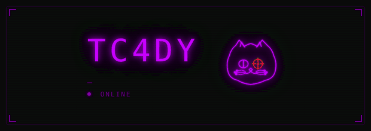

# Hi there! I'm Tc4dy! ࿐✮⋆˙



---

### Who am I ? (bash-5.3$ uname -a) :V
I’m a 16-year-old cybersecurity tester and software developer; I’m also half-human, half-alien. My homeland is Turkey. At night, I write astral travel programmes and delete the code of companies that write closed-source code; I also look a bit like a sea lion. I live on the ninth planet (the Wi-Fi’s brilliant, the pizza delivery’s rubbish) and sometimes I dive into Backrooms during debugging sessions. Outside the cyber temple, I harbour a deep love for sea lions. 🦭 #LoveSeaLions

### My Favorite Projects :>

[](https://github.com/tc4dy/vynmeta) [](https://github.com/tc4dy/ironshell-x86) [](https://github.com/tc4dy/godas) [](https://github.com/tc4dy/Catify) [](https://github.com/tc4dy/HuntCat)

---

### My PoC (Proof of Concept) Exploits :s

[](https://github.com/tc4dy/CVE-2026-24061-PoC-Exploit) [](https://github.com/tc4dy/CVE-2026-0073-PoC-Exploit) [](https://github.com/tc4dy/CVE-2026-98432-PoC-Exploit) [](https://github.com/tc4dy/CVE-2026-29000-PoC-Exploit) 

[](https://github.com/tc4dy/CVE-2026-54121-PoC-Exploit) [](https://github.com/tc4dy/CVE-2026-61511-PoC-Exploit) [](https://github.com/tc4dy/CVE-2026-65643-PoC-Toolkit) [](https://github.com/tc4dy/CVE-2026-41091-PoC-Exploit)

---

## Features & Interests
* **Research & Exploitation:** Writing PoC exploits for real-world daily vulnerabilities, UEFI & TPM, Buffer Overflow (BoF), Reverse Engineering, Privilege Escalation (PrivEsc), web pentest scripting etc., Kernel and system-level vulnerability investigation. Tool and exploit renewal and modification. Reporting vulnerabilities.
* **Operating Systems:** Linux customization & configuration, operating system debloating (Windows & Linux), BSD family & Linux hardening. UEFI persistent virus writing attempts and code reviews. Exploiting kernel-level code compilation vulnerabilities.
* **Privacy & Security:** Kernel & hardware-level OpSec (Intel ME, TPM, coreboot & libreboot customization), telemetry removal, Open-source hardware (RISC-V, POWER9, lowRISC), custom ROM, i2p, Lokinet, GNU Net, Nym, Tor configuration. 
* **Programming:** **Python**, Go Lang, C Family, Java, (With Scripting), Assembly for Kernel, Rust, Bash/PowerShell Automation.

---

<p align="left">
<a href="https://www.credly.com/badges/penetration-tester"></a><a href="https://www.credly.com/badges/exploit-developer"></a><a href="https://www.credly.com/badges/reverse-engineering"></a><a href="https://www.credly.com/badges/malware-analysis"></a><a href="https://www.credly.com/badges/incident-responder"></a><a href="https://www.credly.com/badges/low-level-firmware-developer"></a><a href="https://www.credly.com/badges/threat-hunter"></a><a href="https://www.credly.com/badges/forensic-analyzer"></a><a href="https://www.credly.com/badges/red-teamer"></a><a href="https://www.credly.com/badges/golang-developer"></a><a href="https://www.credly.com/badges/assembly-language-programmer"></a><a href="https://www.credly.com/badges/embedded-security"></a><a href="https://www.credly.com/badges/python-developer"></a><a href="https://www.credly.com/badges/vulnerability-researcher"></a>
</p>

---

### Technologies & Tools
<p align="left">
  
  
  
  
  
  
  
  
  <br /><br />
  
  
  
  
  
  
  <br /><br />
  
  
  
  
  
  
  <br /><br />
  
  
  
  
  
  <br /><br />
  
  
  
  
  
  <br /><br />
  
  
  
  
  
  
  <br /><br />
  
  
  
  
  
  
  <br /><br />
  
  
  
  
  
</p>

---


### Other Statics
  


<h2>Project's </h2>

[](https://github.com/tc4dy/support-tor-for-freedom)

**Support Tor for Freedom** — Beginner-friendly guide to fight censorship by running Tor relays, bridges & Snowflake. Ready-to-use configs & free VPS list.

[](https://leavemyinternet.github.io)

**LeaveMyInternet** — An open source awareness project fighting for a free, private, and untracked internet.

[](https://beautifulsource.github.io)

**BeautifulSource** — A comprehensive guide to open source alternatives for everyday closed-source software.

## Contact
### Session Message (https://getsession.org/) ID:
```bash
0578d8873eeb67a0f504752e65f0efabf23debf44d8842077997fadb8700207273
```
